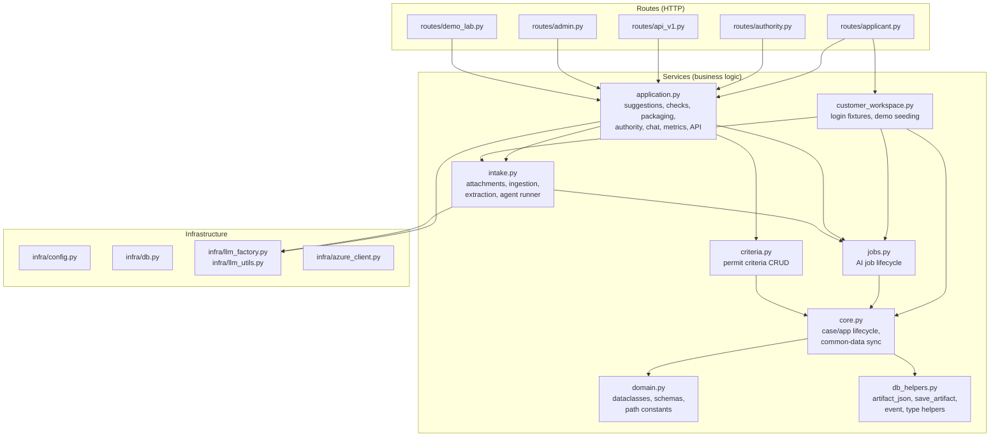

# Architecture — KEHA LV Demo

Single source of truth for how modules connect. Read this first.

## Folder map

```
keha-lv-jaettava/
  app/
    main.py                         FastAPI entry point, mounts router, /healthz
    infra/                          Infrastructure (no business logic)
      config.py                       Settings from env vars
      db.py                           SQLite: cases, files, artifacts, settings
      llm_factory.py                  create_llm_client() → Azure AI Foundry (raises if unconfigured)
      llm_utils.py                    call_llm_json(), JSON extraction, rate limiting
      azure_client.py                 Foundry Responses API client (capability-adaptive)
      session.py                      DemoSessionMiddleware: signed browser session
    domains/lupademo/
      routes/                        HTTP handlers (thin — delegate to services)
        __init__.py                    create_lupademo_router()
        applicant.py                   68 handlers — wizard, intake, forms, chat
        authority.py                   9 handlers — queue, detail, observations
        api_v1.py                      17 handlers — external suggestion-service API
        admin.py                      12 handlers — criteria admin, playground, jobs
        demo_lab.py                   24 handlers — benchmark, metrics, audit
        common.py                     Shared route helpers + Jinja2 filters
                                        (finnish_datetime, FINDING_CATEGORY_LABELS,
                                        job_eta_seconds, RouteContext)
      services/                      Business logic (no HTTP)
        domain.py                     Dataclasses, schemas, path constants, prompts
        db_helpers.py                 artifact_json, save_artifact, event
        core.py                       Case/app lifecycle, common-data sync
        criteria.py                   Permit criteria CRUD, history, rules
        jobs.py                       AI job lifecycle
        intake.py                     Attachments, ingestion, extraction, agents
        customer_workspace.py         Customer workspace: login fixtures, package-case mapping
        application.py                Suggestions, checks, packaging, authority, chat,
                                      metrics, external API
        __init__.py                   Re-exports — `import services as svc` works
      templates/                     31 Jinja2 HTML templates
      static/                        CSS + fonts
      specs/                         Runtime specs (JSON — loaded by app)
        form_schemas/                  3 permit form schemas
        criteria_sets/                 5 permit criteria sets
        prompts/                      12 AI agent prompt templates (.md)
        scenarios/                     Demo scenarios + material stories
      scenarios.py                   Demo scenario seeding (code fallback)
      security.py                    API key auth for suggestion-service
      tenants.json                   Demo API tenants + keys
  docs/                             Design docs (NOT loaded at runtime)
    product-architecture.md        Product design — user journeys, principles
    archive/                       Historical / design-phase artifacts
      v5-specs/                      Early design sketches (domain, roles, UI, workflow, contracts)
  tests/                            Unit tests (tests/fake_llm.py test double, temp DB)
  testiaineisto/                    Test materials (sample zip uploads, gitignored)
  graphify-out/                     Dependency graph analysis artifacts (gitignored)
```

## Dependency graph



**Key rule:** dependencies flow downward. No circular imports.

## Data flow

```
Browser → FastAPI route → svc.function() → DB artifact (SQLite JSON doc)
                                              ↓
                                         AI agent (Azure AI Foundry)
                                              ↓
                                         svc.save_artifact() → DB
```

All state lives in SQLite `artifacts` table as JSON documents keyed `{case_id}:{type}:{name}`.

## Wizard step → API calls

The applicant wizard (`routes/applicant.py`) is a 6-step flow. Each step renders
via `GET /cases/{case_id}/lupademo/application/{application_id}/wizard/{step}`
and triggers the POST endpoints below. `{application_id}` is the permit type
(e.g. `environmental_industrial`). All AI work runs as background jobs polled
through `/api/v1/jobs/{job_id}`.

### Step 1 — Perustiedot (LV-yhteiset tiedot)

| Method | Path | Purpose |
|--------|------|---------|
| `POST` | `/cases/{case_id}/lupademo/application/{application_id}/save` | Save common/applicant data; `redirect_to` → wizard/2 |

### Step 2 — Aineistot (upload + analyze)

| Method | Path | Purpose | AI job |
|--------|------|---------|--------|
| `POST` | `.../materials/upload-files` | Multi-file / zip / text upload | `material_ingest` |
| `POST` | `.../materials/upload-zip` | Zip-only upload | `material_ingest` |
| `POST` | `.../materials/add-text` | Add text material (AI-only) | — |
| `POST` | `.../attachments/{id}/scope` | Change delivery scope | — |
| `POST` | `.../attachments/{id}/metadata` | Update primary type / scope | — |
| `POST` | `.../attachments/{id}/delete` | Delete attachment | — |
| `POST` | `.../ai/intake-analysis` | **"Analysoi aineisto AI:lla"** — light analysis, extracts fields into review queue, no gap/criteria check | `intake_analysis` (`full_check=False`) |
| `POST` | `.../save` | Save the form fields | — |

`material_ingest` builds the case vector store (`ingest_file_row_to_case_vector_store`).
The light `intake_analysis` writes `field_extraction_queue` (feeds step 3's
"Tarkista AI-ehdotukset") and `intake_analysis` artifact. It does **not** make
suggestions or run criteria.

### Step 3 — AI-ehdotukset (review suggestions)

| Method | Path | Purpose | AI job |
|--------|------|---------|--------|
| `POST` | `.../ai/suggest-form` | **"AI-suositukset liitteistä"** — batch suggestions for all `ai_suggest` fields | `form_suggestions` |
| `POST` | `.../ai/suggest-field` | Per-field suggestion (dropdown) | `field_suggestion` |
| `POST` | `.../extractions/accept` | Accept an extraction-queue item (from step 2) | — |
| `POST` | `.../suggestions/{id}/accept` | Accept one AI suggestion | — |
| `POST` | `.../suggestions/accept-selected` | Accept selected / all suggestions | — |
| `POST` | `.../suggestions/{id}/reject` | Reject one suggestion | — |
| `POST` | `.../chat` | Contextual chat (form post) | — |
| `POST` | `.../chat/messages` | Contextual chat (JSON) | — |
| `POST` | `.../chat/stream` | Contextual chat (SSE stream) | — |
| `POST` | `.../voice/mock` | Voice assistant (reports `disabled`; no simulated speech) | — |

`form_suggestions` runs `create_field_suggestion` per field **within one job**
(no per-field sub-jobs) and marks each field agent complete as it finishes.

### Step 4 — Tarkistus (AI + rule check)

| Method | Path | Purpose | AI job |
|--------|------|---------|--------|
| `POST` | `.../ai/check` | **"Aja tarkistus"** — full check: deterministic + completeness/consistency agents + criteria assessor + precheck report | `application_check` |

Writes `check_report`, `criteria_assessment`, `applicant_precheck_report`,
`precheck_gate`. Blocking issues block submission.

### Step 5 — Paketointi (submission package)

| Method | Path | Purpose |
|--------|------|---------|
| `GET` | `.../wizard/5` | Renders package; composes `submission_package` on demand if attachments exist |
| `POST` | `.../submit` | Submit — runs `ensure_fresh_precheck_or_raise`; redirects to receipt or back to step 4 on blocking issues |

### Step 6 — Vastaanotto (receipt)

| Method | Path | Purpose |
|--------|------|---------|
| `GET` | `.../wizard/6` | Renders receipt view |
| `GET` | `.../receipt` | Receipt page |

### Job polling (used by the AI banner)

| Method | Path | Purpose |
|--------|------|---------|
| `GET` | `/api/v1/jobs/{job_id}` | Poll job status (progress, current agent) |
| `GET` | `/api/v1/jobs/{job_id}/stream` | SSE status stream |
| `GET` | `/api/v1/jobs/{job_id}/events` | Agent event list |

The banner (`templates/shared/_ai_job_bar.html`) polls every 4s and auto-reloads
with a `?t=` cache-buster when all jobs reach a terminal state.

## Kevytasiointi service view → API calls

The kevytasiointi service view (`/applicant/packages/*`) is a **separate path**
from the wizard. It starts from a permit type, municipality, and raw material,
then fills the application with AI prose suggestions in a persistent side
panel. Submitting the LV-side form creates a REAL customer-owned hanke
(`created_from="kevytasiointi"`) and `permit_application` immediately — there
is no promote step. Routes live in `routes/applicant.py`.

> **Do not mix-match.** The kevytasiointi view (Path A, material-first) and the
> wizard (Path B, form-first) are two distinct entry flows. Both create the
> customer-owned hanke and application immediately; Path A links back to its own
> service view, Path B to the wizard. Their routes, templates, and handlers are
> separate. See `AGENTS.md` → "Two entry paths (do NOT mix-match)" for the full
> comparison.

### Create + ingest

| Method | Path | Purpose | AI job |
|--------|------|---------|--------|
| `GET` | `/applicant/packages/new` | New-package form | — |
| `POST` | `/applicant/packages/new` | Create a real hanke + application + pending package, start ingest | `material_ingest` |
| `GET` | `/applicant/packages/{package_id}` | Render service view (polls active job) | — |

`POST /applicant/packages/new` validates the signed-in customer's permit type
and municipality, calls `scenarios.create_generic_project(...,
created_from="kevytasiointi")`, then `create_pending_material_package(...)`
plus `start_material_ingest_job` and `execute_material_ingest_job` in the
background. The package uses the municipality's criteria set and is marked
`ready`.

### AI prose side panel

| Method | Path | Purpose | AI job |
|--------|------|---------|--------|
| `POST` | `/applicant/packages/{package_id}/ai-prose` | Prose suggestion payload for the side panel | synchronous |

Returns JSON with `prose_md` and a `fields` list; the side panel renders it and
offers per-field copy buttons. No criteria gate — prose suggestions come from
the material only.

### Analyze (attachment-only pipeline)

| Method | Path | Purpose | AI job |
|--------|------|---------|--------|
| `POST` | `/applicant/packages/{package_id}/analyze` | **"Analysoi aineisto tekoälyä varten"** — attachment-only analysis | `intake_analysis` (`attachment_only=True`) |

Guards: 409 if package not `ready` or an `intake_analysis` job is already
running. Runs `start_intake_analysis_job` (`attachment_only=True`) +
`execute_intake_analysis_job` in the background.

### Job polling

Same endpoints as the wizard banner: `GET /api/v1/jobs/{job_id}` (+ `/stream`,
`/events`). The service view's `package_context` tracks the active
`material_ingest` / `intake_analysis` job and shows it in the progress bar.

> **Note:** the service view runs ingest → analysis as two separate jobs
> (each triggered by its own button). It does **not** auto-chain them — the
> user clicks "Analysoi" after the package is `ready`.

## Where to find things

| Question | Module |
|----------|--------|
| What does an Issue/Suggestion look like? | `services/domain.py` |
| How do I read/write artifacts? | `services/db_helpers.py` |
| How do I create a case or application? | `services/core.py` |
| How do I manage permit criteria? | `services/criteria.py` |
| How does the AI job lifecycle work? | `services/jobs.py` |
| How are attachments uploaded/extracted? | `services/intake.py` |
| How does the application check run? | `services/application.py` → `run_application_check()` |
| How does submission packaging work? | `services/application.py` → `compose_submission_package()` |
| Where are the HTTP route handlers? | `routes/{applicant,authority,api_v1,admin,demo_lab}.py` |
| Where are the AI prompt templates? | `specs/prompts/*.prompt.md` |
| Where are the permit form schemas? | `specs/form_schemas/*.schema.json` |
| Where are the permit criteria sets? | `specs/criteria_sets/*.json` |
| How is the DB configured? | `infra/config.py` + `infra/db.py` |
| Which Foundry deployments are used? | `AZURE_OPENAI_MODEL_CORE` / `AZURE_OPENAI_MODEL_CHAT` in `.env` |

## Key design decisions

1. **Artifacts as JSON in SQLite.** Every domain object is a JSON doc, not a relational table. Simple, flexible, no migrations.
2. **Azure AI Foundry only.** Every AI call is a Foundry Responses API request; there is no mock or offline provider. A missing configuration fails loudly.
3. **`svc.*` pattern.** All services re-exported through `__init__.py`. Routes never import from individual service modules — they use `import services as svc; svc.xxx()`.
4. **Routes are thin.** Route handlers validate input, call a service function, return a template/redirect. No business logic in routes.
5. **`app/infra/` not `app/core/`.** Named "infra" to avoid collision with `services/core.py`. Infrastructure code has zero business logic.
6. **Specs live in `app/`.** Runtime specs (schemas, criteria, prompts) live next to the code that loads them. Design archives live in `docs/archive/v5-specs/`.
7. **Submit gate = blocking findings + red criteria.** A `major` finding ("viranomainen
   pyytäisi korjauksen") is surfaced but advisory: it no longer prevents submission, so the
   "estävä" label means what it says. `precheck_gate_status()` is the single source of truth.
8. **No pre-seeded content.** The seeding script, per-customer starter hankkeet and presenter replay are gone. Each account starts empty and every AI step is a real Foundry call.

## Route inventory

For a complete, machine-checkable table of every HTTP route (method, path,
handler, module, template), see [`docs/route-inventory.md`](docs/route-inventory.md).
