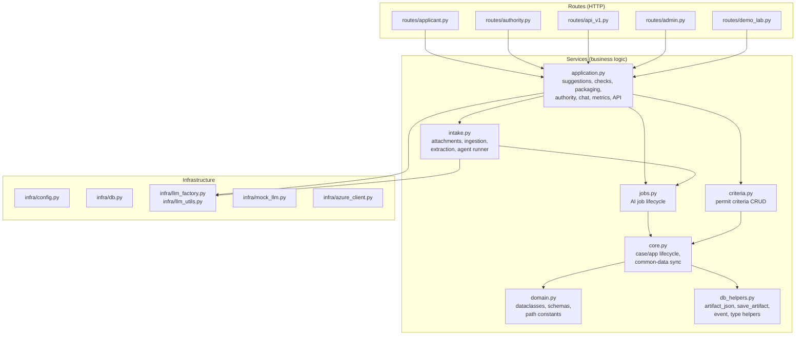

# Architecture — KEHA LV Demo

Single source of truth for how modules connect. Read this first.

## Folder map

```
keha-lv-jaettava/
  app/
    main.py                         FastAPI entry point, mounts router, /healthz
    infra/                          Infrastructure (no business logic)
      config.py                       Settings from env vars
      db.py                           SQLite: cases, files, artifacts, settings
      llm_factory.py                  create_llm_client() → mock | Azure
      llm_utils.py                    call_llm_json(), rate limiting
      mock_llm.py                     Rule-based mock LLM (default, offline)
      azure_client.py                 Azure OpenAI client
    domains/lupademo/
      routes/                        HTTP handlers (thin — delegate to services)
        __init__.py                    create_lupademo_router()
        applicant.py                   42 handlers — wizard, intake, forms, chat
        authority.py                   9 handlers — queue, detail, observations
        api_v1.py                      7 handlers — external suggestion-service API
        admin.py                      22 handlers — criteria admin, playground, jobs
        demo_lab.py                   14 handlers — benchmark, metrics, audit
        common.py                     Shared route helpers
        template_filters.py           Jinja2 filters
      services/                      Business logic (no HTTP)
        domain.py                     Dataclasses, schemas, path constants, prompts (~350L)
        db_helpers.py                 artifact_json, save_artifact, event (~80L)
        core.py                       Case/app lifecycle, common-data sync (~250L)
        criteria.py                   Permit criteria CRUD, history, rules (~180L)
        jobs.py                       AI job lifecycle (~350L)
        intake.py                     Attachments, ingestion, extraction, agents (~1500L)
        application.py                Suggestions, checks, packaging, authority, chat,
                                      metrics, external API (~2700L)
        __init__.py                   Re-exports — `import services as svc` works
      templates/                     22 Jinja2 HTML templates
      static/                        CSS + fonts
      specs/                         Runtime specs (JSON — loaded by app)
        form_schemas/                  3 permit form schemas
        criteria_sets/                 3 permit criteria sets
        prompts/                      11 AI agent prompt templates (.md)
        scenarios/                     Demo scenarios + material stories
      scenarios.py                   Demo scenario seeding (code fallback)
      security.py                    API key auth for suggestion-service
      tenants.json                   Demo API tenants + keys
  docs/                             Design docs (NOT loaded at runtime)
    product-architecture.md        Product design — user journeys, principles
    archive/                       Historical / design-phase artifacts
      v5-specs/                      Early design sketches (domain, roles, UI, workflow, contracts)
  tests/                            Smoke tests (mock LLM, temp DB)
  testiaineisto/                    Test materials (sample zip uploads, gitignored)
  graphify-out/                     Dependency graph analysis artifacts (gitignored)
```

## Dependency graph



**Key rule:** dependencies flow downward. No circular imports.

## Data flow

```
Browser → FastAPI route → svc.function() → DB artifact (SQLite JSON doc)
                                              ↓
                                         AI agent (mock or Azure)
                                              ↓
                                         svc.save_artifact() → DB
```

All state lives in SQLite `artifacts` table as JSON documents keyed `{case_id}:{type}:{name}`.

## Where to find things

| Question | Module |
|----------|--------|
| What does an Issue/Suggestion look like? | `services/domain.py` |
| How do I read/write artifacts? | `services/db_helpers.py` |
| How do I create a case or application? | `services/core.py` |
| How do I manage permit criteria? | `services/criteria.py` |
| How does the AI job lifecycle work? | `services/jobs.py` |
| How are attachments uploaded/extracted? | `services/intake.py` |
| How does the application check run? | `services/application.py` → `run_application_check()` |
| How does submission packaging work? | `services/application.py` → `compose_submission_package()` |
| Where are the HTTP route handlers? | `routes/{applicant,authority,api_v1,admin,demo_lab}.py` |
| Where are the AI prompt templates? | `specs/prompts/*.prompt.md` |
| Where are the permit form schemas? | `specs/form_schemas/*.schema.json` |
| Where are the permit criteria sets? | `specs/criteria_sets/*.json` |
| How is the DB configured? | `infra/config.py` + `infra/db.py` |
| How do I swap mock → Azure? | Set `KEHA_LV_LLM_PROVIDER=azure` in `.env` |

## Key design decisions

1. **Artifacts as JSON in SQLite.** Every domain object is a JSON doc, not a relational table. Simple, flexible, no migrations.
2. **Mock LLM by default.** Runs offline with deterministic Finnish responses. No API keys needed.
3. **`svc.*` pattern.** All services re-exported through `__init__.py`. Routes never import from individual service modules — they use `import services as svc; svc.xxx()`.
4. **Routes are thin.** Route handlers validate input, call a service function, return a template/redirect. No business logic in routes.
5. **`app/infra/` not `app/core/`.** Named "infra" to avoid collision with `services/core.py`. Infrastructure code has zero business logic.
6. **Specs live in `app/`.** Runtime specs (schemas, criteria, prompts) live next to the code that loads them. Design archives live in `docs/specs/`.
