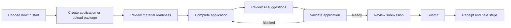
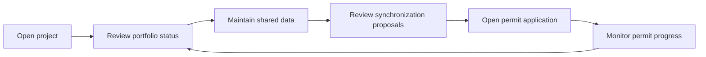
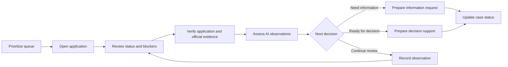
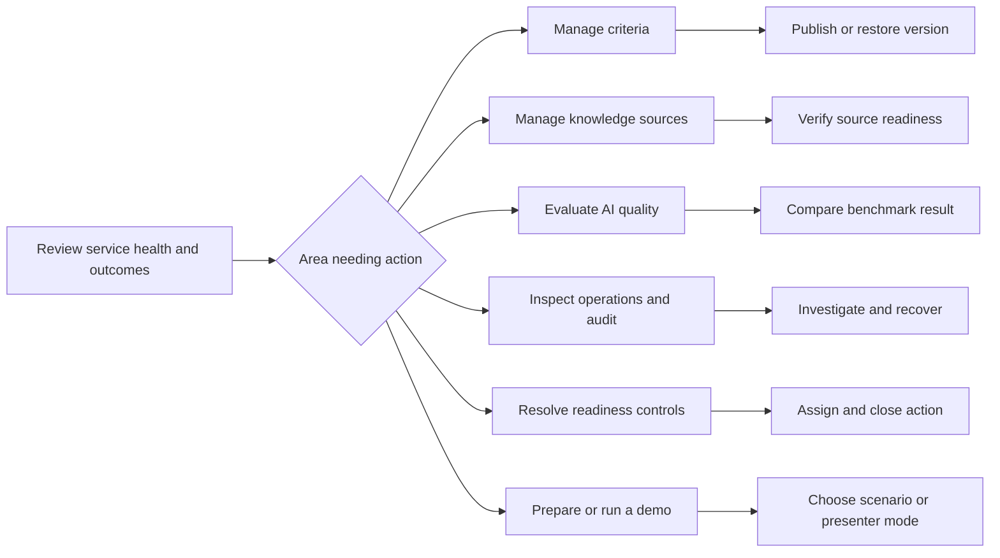
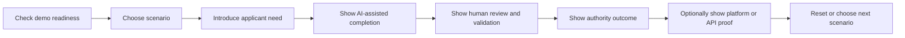

## Product intent

Lupa-apuri helps an applicant produce a complete, internally consistent permit
application that an authority can process with less avoidable follow-up work.
Every product decision starts from that need and ends at a meaningful outcome:
a submitted application, a clear authority decision path, or evidence that the
service improves those outcomes.

The UI follows the user's journey rather than route modules, artifacts, AI
pipelines, or backend ownership. Technical capabilities support the journey but
do not define its visible structure.

### Product outcomes

* Applicants know what is missing, contradictory, or blocking before submission
* Applicants remain in control of every AI-proposed change
* Applicants and LV users maintain shared project information once across a permit portfolio
* Caseworkers identify the next casework decision without reading raw system data
* Demo Lab and Platform operators govern criteria, integrations, evidence, quality, and readiness
* Presenter mode demonstrates a coherent value story without creating another product identity

### Product principles

1. Give every page one primary user job.
2. Give every major activity one canonical home.
3. Show status, recommended next action, and blockers together.
4. Organize every page into overview, work area, and details.
5. Use progressive disclosure for evidence, history, diagnostics, and technical data.
6. Use applicant and caseworker language in user-facing workspaces.
7. Keep AI suggestions reviewable, evidenced, and human-controlled.
8. Reuse the product system before introducing a local pattern.
9. Preserve deep links and predictable browser back behavior.
10. Reduce failure demand before optimizing local page aesthetics.

## Product diagnosis

### Current product areas

| Current area | Templates | Current concern |
|---|---|---|
| Applicant entry | `applicant/landing.html`, `applicant/applicant_start.html` | Two starts overlap in project and applicant data capture |
| Material intake | `applicant/package_new.html`, `applicant/package_workbench.html`, wizard step 2 | Upload, analysis, document management, and AI field review are duplicated |
| Application workflow | `applicant/wizard.html`, `applicant/receipt.html` | One template owns too many jobs; submission preview and receipt have duplicate representations |
| LV project portfolio | `applicant/lv_project.html` | Shared data and permit status coexist with integration evidence |
| Authority casework | `authority/authority_queue.html`, `authority/authority_detail.html` | Operational work is coherent, but presenter proof and technical event data leak into the workspace |
| Suggestion service | `admin/suggestion_service.html`, `admin/api_demo.html`, `admin/ui_only.html` | Product choice, clerk tool, API playground, tenant metadata, and credentials are mixed |
| Platform operations | `admin/criteria.html`, `admin/metrics.html`, `admin/benchmark_lab.html`, `admin/audit_trail.html`, `admin/production_hardening.html` | Governance, impact, telemetry, evaluation, corpus operations, and readiness overlap |
| Demo presentation | `admin/demo_lab.html`, `admin/presenter.html`, `admin/scenarios.html` | Capabilities use the shared `shared/light_base.html` shell |
| Reporting | `admin/metrics_report.html` | Outcome metrics and implementation diagnostics are combined without context |

### Pages that belong together

* Applicant entry, application creation, material intake, form completion, AI review,
  validation, submission review, and receipt form one applicant journey
* LV project overview, shared data, change reconciliation, and permit portfolio form
  one project-management journey
* Authority queue, application review, observations, information request preparation,
  decision support, and status progression form one casework journey
* Criteria, knowledge sources, service operations, metrics, evaluation, audit,
  readiness, integrations, and demo controls form one Demo Lab and Platform
  workspace with separate capabilities

### Mixed or misplaced responsibilities

* `wizard.html` mixes shared-data reconciliation, form editing, document management,
  AI review, chat, voice, validation, packaging, submission, receipt, and diagnostics
* `package_workbench.html` accepts AI-found field values even though AI suggestion
  review must have one canonical home in wizard step 3
* `metrics.html` mixes business impact, operational telemetry, implementation
  readiness, benchmark data, and executable diagnostics
* `criteria.html` mixes policy authoring, knowledge-source ingestion, vector-store
  state, benchmark setup, raw JSON editing, and test execution
* `lv_project.html` exposes integration events that belong in platform observability
* Authority templates include demo proof content that belongs in Presenter
* Suggestion Service home exposes tenant credentials and request history beside
  user-facing product choices
* All templates now extend `shared/light_base.html` (legacy shells removed)

### Implementation architecture exposed to users

The current UI contains terms such as `extraction queue`, `delivery_scope`,
`vector store`, `fallback`, `agent chain`, `field_id`, `tenant`, `Responses API`,
and raw JSON. These terms are appropriate only in Demo Lab/Platform when
needed to prove technical behavior.

User-facing language maps technical concepts to decisions:

| Internal concept | Applicant or authority language |
|---|---|
| Extraction queue | AI:n löytämät tiedot |
| Package analysis | Aineiston tarkistus |
| Structured fields | Hakemuksen tiedot |
| Delivery scope | Toimitetaanko viranomaiselle |
| Evidence reference | Lähde ja perustelu |
| Blocking finding | Lähetyksen este |
| Major finding | Korjattava kohta |
| Pending suggestion | Tarkistettava ehdotus |
| Vector-store state | Hidden outside platform operations |
| Fallback or agent chain | Hidden outside AI operations and demo evidence |

## Roles and jobs

### Applicant

Primary job: submit a complete and correct application on the first attempt.

Secondary jobs:

* Start a new application or continue a draft
* Upload and classify supporting material
* Complete application fields
* Review AI-found information with its source
* Resolve missing information, contradictions, and submission blockers
* Verify what will be sent and retain a receipt

Needs to know:

* Current application status and completion level
* What to do next
* What is missing or contradictory
* Which AI suggestions await a decision
* Which documents will be sent to the authority
* Why submission is blocked

Hidden by default:

* Agent names, prompts, model identifiers, fallback state, vector stores, raw JSON,
  tenant configuration, benchmark data, and internal audit payloads

The Applicant role also owns the LV-facing project capability. This capability
provides project creation, shared applicant and location data, synchronization
proposals, permit portfolio status, and entry into each permit application. It is
part of the applicant journey, not a separate product role or workspace.

### Caseworker

Primary job: review a submitted application and decide the next casework action.

Secondary jobs:

* Prioritize the work queue
* Verify application data and official attachments
* Assess AI-supported observations
* Prepare an information request or decision memo
* Record observations and advance case status

Needs to know:

* Case urgency, status, SLA, and material completeness
* The next unresolved decision
* Evidence supporting each AI observation
* Which information is applicant-provided and which is AI-generated
* A reliable history of caseworker actions

Hidden by default:

* Applicant-only background material, prompts, raw traces, vector-store identifiers,
  demo controls, platform benchmarks, and tenant credentials

### Demo Lab or Platform operator

Primary job: govern service quality, policy, evidence, and operational readiness.

Secondary jobs:

* Manage criteria and versions
* Manage approved knowledge sources
* Monitor outcome and service metrics
* Evaluate AI behavior against benchmarks
* Inspect audit and AI operation history
* Track production-readiness controls
* Test external service contracts
* Select demo scenarios and operate presenter mode

Needs to know:

* Scope, version, owner, status, evidence, and last update for governed items
* Meaningful trends and thresholds
* Failed runs and recovery actions
* Which environment, tenant, case, or scenario is in context

Hidden by default:

* Raw payloads, full traces, and low-level diagnostics until intentionally expanded

Presenter is a mode available to the Demo Lab or Platform operator. It adds
curated proof, scene guidance, and recovery links to existing product pages. It
does not create a role, workspace, authorization boundary, or duplicate workflow.

## Workflow model

### Applicant workflow

Canonical activity homes:

* Starting and resuming: Applicant Home
* Upload and document management: Materials
* Application form editing: Application Details
* Accepting and rejecting AI suggestions: AI Review
* Missing information and blockers: Validation
* Official package verification: Review and Submit
* Confirmation: Receipt

Rules:

* Package upload may prefill an application, but it must not create a parallel
  suggestion-acceptance workflow
* Materials can link to AI Review with a pending count, but acceptance happens there
* Validation links each issue back to the exact form field, attachment, or suggestion
* Submission remains disabled only when accompanied by a clear reason and recovery action

### Applicant project and portfolio workflow

The project is the context and portfolio, not a second application editor. Shared
fields remain canonical in the LV-facing project capability; application-specific
fields remain canonical in the application workflow. Both belong to the
Applicant/LV-facing workspace.

### Caseworker review workflow

AI assists preparation but never determines authority status. Every AI observation
must expose evidence and a human disposition.

### Demo Lab and Platform workflow

Outcome metrics, operational telemetry, and technical diagnostics are separate
views. A metric can deep-link to evidence without placing all evidence on the dashboard.

### Presenter mode flow

The default narrative proves customer value. Technical proof is an optional branch,
not part of the normal applicant or caseworker journey. Every scene opens an
existing capability in one of the three workspaces.

## Workspace architecture

The product has three top-level workspaces. A workspace is an operating context
for one product role, not a backend module, route prefix, capability, or display
mode. Integrations are a Demo Lab and Platform capability. Presenter is a mode.

### Applicant and LV-facing workspace

Purpose: manage a permit project and create, complete, validate, and submit its
applications.

Navigation:

* Home
* Project
* Applications
* Materials

Primary pages:

* Applicant home and start choice
* Project overview, shared information, synchronization proposals, and permit portfolio
* New application
* Material upload and document management
* Application workspace with Details, AI Review, Validation, Review and Submit
* Receipt

Excluded:

* Criteria, metrics, benchmarks, API testing, raw AI telemetry, demo controls,
  authority-only materials, and production readiness

### Caseworker workspace

Purpose: process submitted applications and prepare official follow-up.

Navigation:

* Work Queue
* My Cases

Primary pages:

* Cross-case work queue
* Application review workspace
* Information request preparation
* Decision support and case history

Excluded:

* Applicant drafts, applicant-only AI context, demo controls, criteria editing,
  API playgrounds, and raw AI traces

### Demo Lab and Platform workspace

Purpose: govern service behavior, policy, quality, operations, and readiness.

Navigation:

* Overview
* Criteria
* Knowledge Sources
* Impact
* AI Operations
* Evaluation
* Audit
* Readiness
* Integrations
* Scenarios
* Presenter

Primary pages:

* Demo Lab and Platform overview with exceptions and recommended actions
* Criteria list, editor, version history, and test
* Knowledge-source status and ingestion
* Outcome and adoption metrics
* AI runs, failures, and recovery details
* Benchmark lab
* Audit trail
* Production readiness controls
* Suggestion Service overview, clerk tool, and API playground
* Scenario launcher and presenter controls

Excluded:

* Applicant application tasks and caseworker decisions

Presenter mode may deep-link from this workspace into prepared Applicant/LV-facing
or Caseworker states. The destination remains visually and semantically in its
own workspace.

## Navigation model

### Global product header

The global header is stable across all workspaces and contains:

1. Product identity linking to the current workspace home
2. Current workspace identity and authorized workspace choices
3. User or demo identity and an account menu when authentication exists

The header does not contain project-specific navigation or a list of every product area.
Normal users do not see workspaces they cannot access. Presenter mode is a
separate control in Demo Lab and Platform and never appears as a workspace choice.

### Workspace navigation

Desktop uses a persistent left sidebar below the global header. It contains only
the current workspace's destinations. The current destination is identified by
text, weight, and an active indicator, not color alone.

Rules:

* Use no more than eight visible first-level destinations before grouping
* Keep Demo Lab/Platform groups collapsible by capability
* Keep Applicant/LV-facing and Caseworker navigation short and task-oriented
* Do not mix workspace switching and page navigation at the same hierarchy level
* Preserve URLs for deep links and browser history

### Project context bar

Show the context bar only when a project, application, or authority case is open.
It contains:

* Project or case name
* Applicant and municipality when relevant
* Permit type or portfolio context
* Current status
* Context switcher when the role can access multiple projects or cases

It does not contain page actions. Status links to the relevant status explanation
or validation view.

### Page header

Each page header contains:

* Breadcrumbs for pages at least three levels deep
* One task-oriented page title
* One concise context or status sentence
* One primary action at most
* Secondary actions in a compact action group or overflow menu

### Page-level status and next action

Every task page begins with a `StatusSummary` paired with a
`RecommendedNextAction` unless the page itself is a simple creation form or receipt.
Together they answer:

* Where am I?
* What is the current status?
* What should I do next?
* Am I blocked?

### Stepper and breadcrumbs

Use a stepper only for a bounded, ordered process with a meaningful completion point.
The Applicant application process uses these steps:

1. Perustiedot
2. Aineistot
3. Hakemus
4. AI-ehdotukset
5. Tarkistus
6. Lähetys

The receipt is an outcome page after the stepper, not an editable step.

Use breadcrumbs for hierarchical navigation, especially Demo Lab/Platform and Caseworker.
Do not use breadcrumbs as a substitute for workflow progress.

### Page actions

* Place the primary action in the page header or sticky action footer, not both
* Use one primary action per page state
* Pair disabled actions with a visible reason and recovery link
* Keep destructive actions separate and require confirmation
* Preserve entered data when navigating backward through long forms

## Component system

These components are product contracts, not visual one-offs.

### AppShell

Purpose: provide stable product identity, workspace switching, navigation, skip link,
and main-content focus target.

Use for: every interactive product page.

Do not use for: printable reports and embeddable external widgets.

Required content: product link, current workspace, authorized workspace options,
workspace navigation, main landmark.

Variants: Applicant/LV-facing, Caseworker, Demo Lab/Platform. Presenter is a
mode modifier, not a variant.

### WorkspaceHeader

Purpose: identify the active workspace and provide its first-level navigation.

Use for: all AppShell variants.

Do not use for: page-specific context or actions.

Required content: workspace name, active navigation state.

Variants: compact, grouped Demo Lab/Platform.

### ProjectContextBar

Purpose: maintain project, case, applicant, and permit orientation across deep pages.

Use for: project, application, and authority-case contexts.

Do not use for: workspace home pages without a selected context.

Required content: context name, status, relevant identity, context-selection affordance.

Variants: project, application, authority case.

### PageHeader

Purpose: state the page's primary job and expose its main action.

Use for: every routed page.

Do not use for: repeated sections inside a page.

Required content: title, concise supporting sentence, optional breadcrumbs, zero or one
primary action.

Variants: standard, compact, outcome.

### Stepper

Purpose: show ordered progress through the applicant workflow.

Use for: the six-step application process.

Do not use for: workspace navigation, admin capability groups, or receipt.

Required content: numbered steps, labels, current step, completed state, accessible
current-step semantics.

Variants: standard desktop, compact narrow viewport.

### StatusSummary

Purpose: summarize readiness, progress, or operational state in decision language.

Use for: application, project, authority case, platform service, benchmark, or readiness status.

Do not use for: decorative counts with no decision consequence.

Required content: plain-language status, short reason, relevant count or timestamp,
blocker indication using icon and text.

Variants: neutral, in progress, ready, attention, blocked, completed.

### RecommendedNextAction

Purpose: turn status into the next useful action.

Use for: all active task pages and actionable empty states.

Do not use for: receipts or historical reports without an action.

Required content: one recommended action, reason, destination or command, optional
secondary alternative.

Variants: normal, blocked recovery, waiting for external party.

### FormSection

Purpose: group related fields with shared guidance and completion state.

Use for: application and shared-data forms.

Do not use for: unrelated controls grouped only for layout.

Required content: heading, optional summary, visible labels, required indicators,
field-level help and errors.

Variants: expanded, collapsed, complete, attention, read-only.

### DocumentPanel

Purpose: own document upload and material-level actions.

Use for: Materials and authority official-evidence review.

Do not use for: accepting AI field suggestions.

Required content: purpose statement, upload action where allowed, document counts,
clear distinction between official attachments and AI-only background material.

Variants: applicant editable, authority read-only, compact summary.

### DocumentList

Purpose: scan and manage document metadata consistently.

Use for: applicant materials, submission review, authority evidence, and knowledge sources.

Do not use for: raw filesystem or object-store internals.

Required content: filename, user-facing type, purpose, state, relevant action.

Variants: editable, selectable, read-only, technical Demo Lab/Platform.

### AISuggestionReviewCard

Purpose: support a human accept, edit, or reject decision with evidence.

Use for: Applicant AI Review and the standalone clerk assistant.

Do not use for: passive AI summaries or automatic application changes.

Required content: target field, current value, suggested value, confidence expressed in
plain language, source evidence, rationale, accept, edit, and reject actions.

Variants: new value, replacement, contradiction, low confidence, accepted, rejected.

### EvidenceDetails

Purpose: reveal source excerpts and AI rationale without dominating the decision.

Use for: suggestion review, validation issues, and authority observations.

Do not use for: mandatory information needed to understand the primary state.

Required content: source name, relevant excerpt, relationship to the decision.

Variants: collapsed default, expanded, unavailable evidence.

### ValidationIssueCard

Purpose: explain a missing item, contradiction, warning, or submission blocker and how
to resolve it.

Use for: Applicant Validation and authority observations.

Do not use for: technical exceptions without user recovery.

Required content: severity text, issue statement, reason, resolution action, destination,
optional evidence.

Variants: blocker, correction, recommendation, resolved.

### MetricsCard

Purpose: report one outcome or operational measure with context and trend.

Use for: Impact and Platform Overview.

Do not use for: raw counts without a question they answer.

Required content: metric name, formatted value, comparison or threshold, interpretation,
optional drill-down.

Variants: outcome, trend, target, attention.

### AdminDataTable

Purpose: scan, sort, filter, and act on governed platform records.

Use for: criteria, knowledge sources, AI runs, audit, benchmarks, and readiness controls.

Do not use for: small key-value summaries or narrative evidence.

Required content: caption, headers, sortable state where relevant, row identity, status,
last update, row action, empty and error states.

Variants: standard, selectable, expandable technical detail.

### TechnicalDetailsDisclosure

Purpose: hide raw JSON, traces, IDs, diagnostics, and implementation evidence until requested.

Use for: Demo Lab/Platform and optional presenter proof.

Do not use for: user-facing reasons, blockers, or evidence required for a decision.

Required content: descriptive summary label, copy/download affordance where relevant,
monospace content.

Variants: JSON, trace, identifiers, diagnostic log.

### PresenterProofCard

Purpose: guide a presenter from claim to prepared proof and recovery path.

Use for: presenter mode inside Demo Lab/Platform only.

Do not use for: normal applicant, LV, authority, or admin work.

Required content: claim, scene goal, deep link, expected state, optional speaker note and
fallback action.

Variants: applicant value, AI control, authority value, integration proof, readiness warning.

## Page redesign plan

No route changes are required for the first refactoring phases. Templates may move to
new shells and partials while preserving current endpoints.

### `applicant/landing.html`

Target workspace: Applicant.

Primary job: choose how to start or continue.

Hierarchy:

1. Overview with existing drafts and current status
2. Start options: guided application or package upload
3. Secondary explanation of AI assistance

Components: `AppShell`, `PageHeader`, `StatusSummary`, `RecommendedNextAction`.

Move, collapse, or remove:

* Move presenter proof content to Presenter
* Show LV continuation only when a relevant project exists
* Remove marketing-style hero treatment and keep task-oriented copy

Template recommendation: make `/` the canonical Applicant Home and let `/projects/new`
redirect or present a true creation state rather than duplicating the landing page.

### `applicant/package_new.html`

Target workspace: Applicant, Materials.

Primary job: add source material to a new or existing application.

Hierarchy:

1. Application context and accepted material types
2. Upload method and files
3. Privacy and delivery-purpose details

Components: `PageHeader`, `DocumentPanel`, `RecommendedNextAction`.

Move, collapse, or remove:

* Reuse existing project/basic data when present
* Move permit and applicant creation to the explicit application start unless package
  upload is the selected start path
* Keep advanced material-purpose guidance collapsed

Template recommendation: submit to the current backend route, then transition clearly
into Materials for the created application.

### `applicant/package_workbench.html`

Target workspace: Applicant, Materials.

Primary job: verify that uploaded materials are usable and correctly classified.

Hierarchy:

1. Material readiness and next action
2. Findings requiring document-level correction
3. Document list
4. Analysis details

Components: `StatusSummary`, `RecommendedNextAction`, `DocumentPanel`, `DocumentList`,
`TechnicalDetailsDisclosure`.

Move, collapse, or remove:

* Move all field suggestion acceptance to wizard AI Review
* Replace Azure, job, SSE, and agent language with user-facing progress
* Hide technical job details in a Demo Lab/Platform disclosure
* Link pending AI-found information to AI Review with a count

Template recommendation: retain analysis and document management, remove the parallel
field-acceptance forms from this page.

### `applicant/wizard.html`

Target workspace: Applicant, Application.

Primary job: complete one workflow step at a time.

Hierarchy:

1. Project context, application status, and stepper
2. Step-specific status and next action
3. One step-specific work area
4. Evidence and history disclosures

Components: `ProjectContextBar`, `Stepper`, `StatusSummary`, `RecommendedNextAction`,
`FormSection`, `DocumentPanel`, `AISuggestionReviewCard`, `EvidenceDetails`,
`ValidationIssueCard`.

Move, collapse, or remove:

* Make AI Review the only place for accept and reject actions
* Keep Materials focused on upload and document management
* Move technical job logs, feature flags, agent names, fallback state, and raw traces to
  Demo Lab/Platform or `TechnicalDetailsDisclosure` available only in presenter mode
* Remove receipt from the editable stepper
* Move presenter proof sections and environmental showcase timeline to Presenter
* Keep chat contextual and collapsed; do not let it compete with the step job

Template recommendation: split step bodies into Jinja partials while preserving the
single route and backend operations.

### `applicant/lv_project.html`

Target workspace: Applicant/LV-facing.

Primary job: understand portfolio status and take the next project-level action.

Hierarchy:

1. Project status and recommended next action
2. Permit portfolio with status and blockers
3. Shared information and synchronization proposals
4. Project history

Components: `ProjectContextBar`, `StatusSummary`, `RecommendedNextAction`, `FormSection`.

Move, collapse, or remove:

* Move integration event IDs and payloads to Demo Lab/Platform Audit
* Present synchronization conflicts in user language
* Avoid editing application-specific fields here

Template recommendation: keep route aliases initially, but have one canonical URL in
navigation.

### `admin/suggestion_service.html`

Target workspace: Demo Lab/Platform, Integrations.

Primary job: choose and monitor a supported integration mode.

Hierarchy:

1. Service health and usage summary
2. Clerk assistant and API integration entry points
3. Recent service activity
4. Credentials and tenant administration

Components: `StatusSummary`, `RecommendedNextAction`, `MetricsCard`, `AdminDataTable`,
`TechnicalDetailsDisclosure`.

Move, collapse, or remove:

* Put credentials and raw request history behind Demo Lab/Platform permissions and disclosure
* Describe modes by user outcome rather than implementation
* Keep product choice separate from service operations

Template recommendation: use the Demo Lab/Platform shell; link to existing API and UI-only routes.

### `admin/ui_only.html`

Target workspace: Demo Lab/Platform, Integrations, Clerk Assistant.

Primary job: produce reviewable suggestions from pasted or uploaded material.

Hierarchy:

1. Input and permit context
2. Suggestion review
3. Accepted-output summary
4. Technical metadata

Components: `PageHeader`, `AISuggestionReviewCard`, `EvidenceDetails`,
`TechnicalDetailsDisclosure`.

Move, collapse, or remove:

* Replace raw field IDs and criteria suffixes with labels
* Hide tenant and ephemeral-scope details by default
* Explain clearly that acceptance copies output and does not modify an application

Template recommendation: keep its distinct non-integrated contract and do not make it
look like the Applicant application editor.

### `admin/demo_lab.html`

Target workspace: Demo Lab/Platform.

Primary job: choose a platform capability or prepare a demonstration.

Hierarchy:

1. Demo readiness and active scenario
2. Start presenter path
3. Scenario management
4. Optional proof-library links

Components: `StatusSummary`, `RecommendedNextAction`, `PresenterProofCard`.

Move, collapse, or remove:

* Group criteria, metrics, integrations, audit, benchmark, and hardening as platform capabilities
* Keep scenarios and presenter as demo capabilities, not another workspace

Template recommendation: become the Demo Lab/Platform workspace home with grouped
platform and demo capabilities.

### `admin/metrics.html`

Target workspace: Demo Lab/Platform, Impact.

Primary job: understand whether the service improves application quality and processing.

Hierarchy:

1. Outcome status and key interpretation
2. First-time-right and quality measures
3. Trend and comparison views
4. Methodology and export

Components: `StatusSummary`, `RecommendedNextAction`, `MetricsCard`, `AdminDataTable`,
`TechnicalDetailsDisclosure`.

Move, collapse, or remove:

* Move agent telemetry and extraction diagnostics to AI Operations
* Move benchmarks to Evaluation
* Move readiness controls to Readiness
* Keep implementation caveats in methodology disclosure

Template recommendation: extract sections into partials before changing backend data; link
technical sections to their new canonical pages until dedicated routes exist.

### `admin/criteria.html`

Target workspace: Demo Lab/Platform, Criteria.

Primary job: govern and version permit criteria.

Hierarchy:

1. Active version and publication status
2. Criteria list and rule editing
3. Version history and recovery
4. Test against example input

Components: `StatusSummary`, `RecommendedNextAction`, `AdminDataTable`, `FormSection`,
`TechnicalDetailsDisclosure`.

Move, collapse, or remove:

* Move source ingestion and vector-store state to Knowledge Sources
* Move benchmark material to Evaluation
* Put raw JSON editing behind an advanced disclosure and confirmation
* Translate severity and field identifiers in the default view

Template recommendation: preserve existing form routes while presenting separate sections or
tabs; extract knowledge-source and test panels into partials.

### `admin/benchmark_lab.html`

Target workspace: Demo Lab/Platform, Evaluation.

Primary job: determine whether AI behavior meets defined quality expectations.

Hierarchy:

1. Evaluation status and last run
2. Coverage and comparison results
3. Failed or changed cases requiring review
4. Method and technical details

Components: `StatusSummary`, `RecommendedNextAction`, `MetricsCard`, `AdminDataTable`,
`TechnicalDetailsDisclosure`.

Move, collapse, or remove:

* Replace runner and agent IDs with labels initially
* Keep rubric, case identifiers, and raw result payloads in details
* Link missing source material to Knowledge Sources

Template recommendation: retain refresh behavior, label it as updating the evaluation summary
rather than running an unspecified benchmark pipeline.

### `admin/production_hardening.html`

Target workspace: Demo Lab/Platform, Readiness.

Primary job: resolve open controls required for production readiness.

Hierarchy:

1. Readiness status and most important open action
2. Controls grouped by capability
3. Owner, evidence, and remediation
4. Technical evidence

Components: `StatusSummary`, `RecommendedNextAction`, `AdminDataTable`,
`TechnicalDetailsDisclosure`.

Move, collapse, or remove:

* Replace phase and status codes with readiness language
* Add owner and next action only when those data already exist; do not invent them
* Remove duplicate hardening tables from Metrics

Template recommendation: use the existing item data now; preserve room for ownership without
adding unsupported backend fields.

### `admin/presenter.html`

Target workspace: Demo Lab/Platform, presenter mode.

Primary job: guide a reliable demonstration from customer need to outcome.

Hierarchy:

1. Active scenario and readiness
2. Ordered scenes with durations
3. Expected proof and deep link per scene
4. Optional technical proof and recovery

Components: `StatusSummary`, `RecommendedNextAction`, `PresenterProofCard`.

Move, collapse, or remove:

* Replace the legacy LV shell
* Keep API JSON and benchmark details in optional technical proof cards
* Add links only when a valid case context exists

Template recommendation: derive every scene from existing routes and scenario data; do not
duplicate operational controls.

### `applicant/receipt.html`

Target workspace: Applicant.

Primary job: confirm successful submission and explain what happens next.

Hierarchy:

1. Submission success and receipt identifier
2. Submitted application summary
3. Next authority step and expected follow-up
4. Return to applications or project

Components: `PageHeader` outcome variant, `StatusSummary` completed variant,
`RecommendedNextAction` only when another applicant action is required.

Move, collapse, or remove:

* Remove duplicate wizard receipt content
* Format timestamps for Finnish users
* Avoid raw technical identifiers beyond the receipt reference

Template recommendation: make this the canonical post-submit destination and remove receipt
as wizard step 6 in a later route-compatible migration.

### Additional templates

| Template | Target workspace | Primary job | Recommendation |
|---|---|---|---|
| `applicant/applicant_start.html` | Applicant | Create application context | Reconcile with landing start options and avoid recapturing package metadata |
| `authority/authority_queue.html` | Caseworker | Choose next application | Remove presenter proof; make filters persistent and statuses decision-oriented |
| `authority/authority_detail.html` | Caseworker | Decide next casework action | Use evidence-backed observations and collapse history/technical data |
| `admin/api_demo.html` | Demo Lab/Platform | Test external contract | Keep request/response technical; separate widget concept and raw trace details |
| `admin/audit_trail.html` | Demo Lab/Platform | Investigate actions | Format times and labels; use expandable payload rows |
| `admin/metrics_report.html` | Standalone platform report | Share outcome summary | Keep standalone; remove low-level diagnostics or label them as appendix |
| `admin/scenarios.html` | Demo Lab/Platform | Select demo premise | Uses the shared `shared/light_base.html` shell |

## Implementation plan

### Phase 1: Base shells

* Establish three explicit shell states while preserving current route-compatible URL inference
* The canonical AppShell lives in `shared/light_base.html`
* Add workspace identity, capability navigation, global header, main-content focus target,
  and project-context slot
* Legacy shells (`base.html`, `lv_base.html`) have been removed — all templates now extend `shared/light_base.html`
* Preserve all current routes

### Phase 2: Design tokens

* Introduce semantic design tokens from the design system
* Map existing colors and spacing to tokens before changing page composition
* Define focus, status, form, table, disclosure, and layout primitives
* Avoid broad visual restyling until shell behavior and tokens are stable

### Phase 3: Reusable partials

Create Jinja partials for:

* AppShell slots and workspace navigation
* Project context bar
* Page header and breadcrumbs
* Status summary and recommended next action
* Stepper
* Form section
* Document panel and list
* AI suggestion review card and evidence details
* Validation issue card
* Metrics card and admin data table
* Technical details disclosure
* Presenter proof card

Each partial must have at least two real consumers before becoming a general abstraction,
except AppShell primitives that are required globally.

### Phase 4: Applicant pages

* Rationalize landing and application start
* Make Materials the canonical upload and document-management home
* Remove AI acceptance from package workbench
* Split wizard step bodies into partials
* Make AI Review canonical for suggestion decisions
* Make `applicant/receipt.html` the canonical outcome

### Phase 5: Applicant project and Caseworker pages

* Rebuild LV project overview around portfolio status, shared data, and next action
* Move integration evidence to Audit
* Apply Caseworker shell to queue and casework
* Remove presenter proof from operational pages
* Standardize observation evidence and case status patterns

### Phase 6: Demo Lab and Platform pages

* Turn Demo Lab's current links into a capability-grouped workspace overview
* Separate Impact, AI Operations, Evaluation, Audit, Readiness, Criteria, Knowledge
  Sources, Integrations, Scenarios, and Presenter in navigation
* Decompose Metrics and Criteria templates into reusable sections
* Keep raw technical data behind disclosures
* Retain current backend routes until dedicated routes are justified by unique page jobs

### Phase 7: Presenter mode and scenario pages

* Add demo readiness, scenario, and presenter entry to the Demo Lab/Platform home
* Migrate Presenter and Scenarios to the shared shell
* Move proof cards out of normal workspaces
* Curate technical evidence as optional branches
* Validate every deep link against a prepared scenario

### Phase 8: Verification and removal

* Verify keyboard navigation, focus order, heading hierarchy, contrast, and form labels
* Verify all key screens remain deep-linkable and browser back preserves state where possible
* Confirm each page has one primary action and a blocker recovery path
* Remove obsolete duplicated markup and the legacy shell only after behavior parity
* Run tests and desktop browser checks after each workspace migration

## Architecture decisions

### Canonical activity ownership

| Activity | Canonical home |
|---|---|
| Application form editing | Applicant, Application Details |
| Document upload and management | Applicant, Materials |
| AI suggestion review | Applicant, AI Review |
| Validation and checking | Applicant, Validation |
| Submission review | Applicant, Review and Submit |
| Shared project data | Applicant/LV-facing, Project |
| Caseworker review | Caseworker, Casework |
| Metrics | Demo Lab/Platform, Impact |
| Criteria management | Demo Lab/Platform, Criteria |
| Knowledge-source operations | Demo Lab/Platform, Knowledge Sources |
| AI technical operations | Demo Lab/Platform, AI Operations |
| Benchmarks | Demo Lab/Platform, Evaluation |
| Audit | Demo Lab/Platform, Audit |
| Production readiness | Demo Lab/Platform, Readiness |
| Demo presentation | Demo Lab/Platform, Presenter mode |
| API contract testing | Demo Lab/Platform, Integrations |

### Design-debt rule

A new page may introduce a new layout or interaction only when:

1. Its primary job cannot be represented by an existing page archetype or component.
2. The difference is documented in this architecture or the MASTER page override.
3. The new pattern has a clear owner and reuse or retirement plan.

Local visual preference is not sufficient justification.

## Final quality check

| Question | Architecture answer |
|---|---|
| Does every page have one primary job? | Yes in the target model; mixed current pages have explicit decomposition plans |
| Does every page show status and next action? | Required through paired `StatusSummary` and `RecommendedNextAction` contracts |
| Is AI review predictable? | Yes, Applicant AI Review is the only application suggestion-decision home |
| Are platform and demo capabilities coherent? | Yes, they share the Demo Lab/Platform workspace and remain separate capability groups |
| Are technical details hidden by default? | Yes, through workspace boundaries and `TechnicalDetailsDisclosure` |
| Does terminology match user language? | Yes, with an explicit internal-to-user language map |
| Are components reused consistently? | Yes, a canonical component contract governs all workspace redesigns |
| Would a first-time user know what to do next? | The page-header, status, blocker, and recommended-action model requires it |

> [!IMPORTANT]
> The UI Pro Max design-system search returned a marketing-oriented Enterprise
> Gateway with oversized typography. That recommendation conflicts with this
> operational desktop product and was rejected. Only its accessible color,
> typography, density, keyboard, feedback, and breadcrumb guidance informed the
> design direction.
